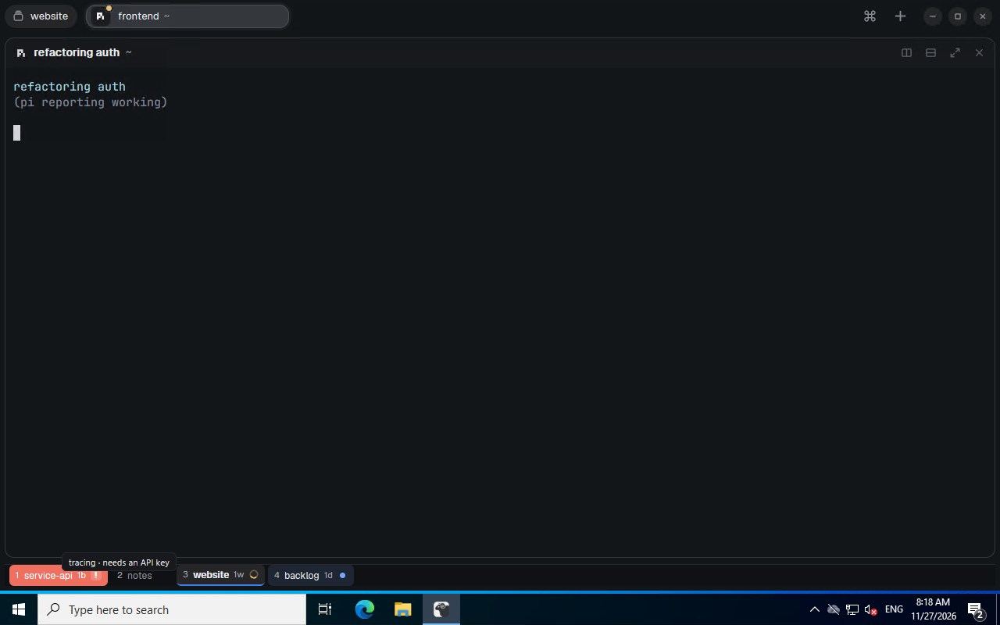

# herdr-fleet

A one-strip fleet status bar for the [Herdr](https://herdr.dev) desktop app (0.1.18+): every space's agents at a glance — blocked inverts, done tints — with click-to-show and the sidebar's right-click space menu. Built for the Terminal layout, where no agents list exists.

See [RECIPE.md](RECIPE.md) for the full brief (what you see, behavior, build notes, checks).

## Install

In your Herdr home (`~/.config/herdr-app`, or `$HERDR_APP_HOME`):

1. Copy `mods/fleet/` to `mods/` (if a `fleet` name is taken, rename it in the folder, the layouts' `mod` fields, and the mod's own `mods/fleet/` asset paths).
2. Copy `layouts/fleet-main.json` and `layouts/fleet-terminals.json` to `layouts/`.
3. `herdr-app check <home>/mods/fleet`, then `herdr-app do layout.switch --name fleet-terminals` (or pick it from the palette; `ctrl-shift-l` switches back).

No keys to merge in v1. To remove: delete the copied files.

## Prototype status

Working prototype, verified live on Windows (see `demo.mp4`, 71s). Statuses cover pane addresses only (sub-agents without a pane are invisible); see RECIPE "Watch out".

## License

MIT. The spinner is adapted from the Herdr app's shipped icon (Apache-2.0); see `mods/fleet/spinner.svg`.
