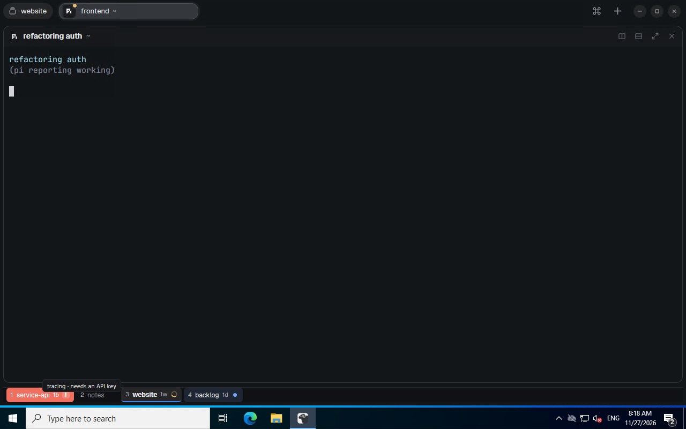

# Fleet

A one-strip fleet status bar for the Herdr desktop app: every space's agents at a glance, always visible. Made for people who live in the Terminal layout, where no agents list exists.

## What you see

A 28px strip pinned to the bottom of the window, above nothing and below everything. One cell per space, in space order, left to right; the strip scrolls horizontally when spaces overflow, and the shown space is scrolled into view when it changes.

Each cell, left to right: the space index (dim, 11px), the space name (12px, semibold when shown, truncated past 140px), agent counts (`1b 2w` style: blocked, done, working — idle never counted), and one status glyph. Empty spaces show dim with no counts and no glyph. With no spaces open, the strip reads "No spaces — open one to see it here".

## How it behaves

- **blocked**: the cell inverts (status-red background, white text): the dwm urgent look. A `!` badge sits at the cell's right edge.
- **done**: the cell tints (`t.done` at low alpha) with a filled dot.
- **working**: default cell with a spinning ring.
- **idle** (agents, all idle): dim with a ring. No agents at all: dim, no glyph.
- The shown space gets a 2px accent underline, on top of any state style.
- Click a cell: shows that space (`space.select`). Right-click: the same space menu as the sidebar (Rename first). Hover: a tooltip with the most urgent agent's tab name and title, plus branch; "All idle" when nothing stirs, the folder for empty spaces.
- No keys in v1 (mouse-first). No timers: the strip re-renders when spaces or agents change.

## Built from

- Layouts (clones; shipped originals untouched): `layouts/fleet-main.json` (`main` + a 28px `fleet` block before `status`, `cloned_from main 0.1.18`), `layouts/fleet-terminals.json` (`terminals` + the block appended, `cloned_from terminals 0.1.18`).
- Mod: `mods/fleet/` (`mod.json` is `{"place": "none", "title": "Fleet"}` so first sight never auto-docks it; `main.js` a `View` reading `spaces()`, `agents()`, `theme()`; `run("space.select")`; `openOverlay` with the shipped `menu` mod exactly as the sidebar calls it).
- Art: `mods/fleet/spinner.svg`, adapted from the shipped `workspace-chrome` spinner (Apache-2.0, see the file comment), so the repo is self-contained.
- Glyph language copied from the shipped agents mod (`agents/main.js` status): spinner, `!`, dot, ring.

## Watch out

- Install the mod folder before switching layouts, or the strip block shows a missing-mod placeholder. `herdr-app check` the mod first.
- Layout clones don't track shipped updates: if `main` or `terminals` change upstream, re-clone and re-add the block.
- Statuses come from pane addresses only: sub-agents without a pane are invisible here (same as `spaces().status`). Folding in `terminals()` is future work.
- `preview.png` is captured from a live window, not generated; resize the window narrow to see the horizontal scroll.
- Sizes: cells truncate names at 140px; counts show blocked/done/working only.

## Done when

- With two spaces (one with a working agent, one empty), the strip shows two cells: counts + spinner on the first, dim name only on the second.
- Clicking the second cell shows that space; the underline moves with it.
- Right-clicking a cell opens the space menu with Rename first.
- An agent going blocked inverts its space cell white-on-red with a `!`.
- Hovering a cell with agents shows `tab name · title`; hovering an empty one shows its folder.
- `herdr-app check mods/fleet` reports nothing wrong.
